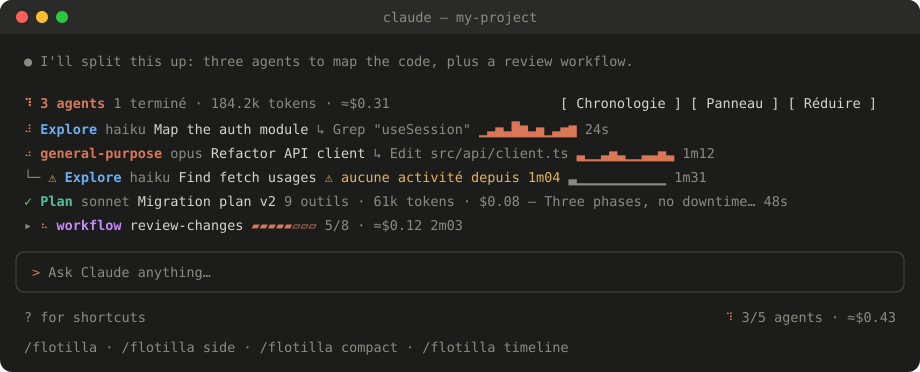

# Flotilla

**Your Claude Code subagents and background tasks, live.** Flotilla is a Claude Code mod that shows every running agent and background task (what it is, what it's doing, how much it costs, and whether it's stuck) right above your prompt, in a side pane, or on a single line.



## Features

- **Live list above the prompt** (default): one row per agent with a spinner, type, model, current tool and target, an activity sparkline, and elapsed time. It disappears 15 s after the last agent finishes.
- **Side pane**: a two-line-per-agent view docked next to the transcript (`/flotilla side`).
- **Compact mode**: everything on one line (`/flotilla compact`).
- **Background tasks**: shell commands run in the background (`Bash`/`PowerShell`, including the ones you push there with Ctrl+B) and `Monitor` watches show up next to the agents. Each one shows its command and how long it's been running, and is marked done, failed or stopped when it ends.
- **Agent tree**: agents spawned by other agents are nested under their parent, and so are the background tasks they start.
- **Stuck-agent alert**: a running agent that hasn't called a tool in 60 s turns orange with `⚠`. A long tool call in flight, such as a slow test run, isn't flagged; its row shows how long it's been running.
- **Results at a glance**: finished agents show the first sentence of their final answer.
- **Model and cost**: a `haiku` / `sonnet` / `opus` / `fable` badge per agent, plus an estimated cost per agent and in total.
- **Workflow groups**: agents started by one workflow collapse into a single row with a progress bar (`▰▰▰▱▱ 3/5`). Click `▸` to expand.
- **Timeline**: bars on a time axis show what ran in parallel and for how long (`/flotilla timeline`, or press `t`).
- **Status line**: `● 3/5 agents · 1 task · ≈$0.43` shows whenever the session has agents, whichever view you use.
- **Loaded check**: for a few seconds after a session starts, or after `/flotilla`, the band reads "Flotilla is on · nothing running" when nothing runs.

Works in the terminal and in the Claude Code tab of the desktop app, in English or French.

## Install

In a Claude Code terminal session:

```
/plugin install flotilla --marketplace aleqsd/flotilla
```

Answer `y` to add the marketplace, then pick the **user** scope so it loads in every session.

Or from your shell:

```bash
claude plugin marketplace add aleqsd/flotilla
```

```bash
claude plugin install flotilla@aleqs-mods --scope user
```

Sessions that were already open pick it up after `/reload-plugins`, or after a restart.

## Usage

Flotilla shows up on its own as soon as an agent starts. To change the view:

| Command | Effect |
| --- | --- |
| `/flotilla` | Detailed list above the prompt (default) |
| `/flotilla side` | Side pane |
| `/flotilla compact` | One line above the prompt |
| `/flotilla timeline` / `/flotilla list` | Switch between timeline bars and rows |
| `/flotilla clear` | Remove finished agents |
| `/flotilla lang en` / `fr` / `auto` | Set the interface language |

Buttons and their hotkeys work once the band or pane has focus:

| Key | Action |
| --- | --- |
| `t` | Toggle timeline / list |
| `p` | Open the side pane |
| `a` | Move back above the prompt (from the pane) |
| `r` | Collapse to one line |
| `e` | Expand from one line |
| `h` | Hide / show finished agents |
| `c` | Clear finished agents (pane) |

Closing the side pane by hand collapses Flotilla to its one-line view, so you don't lose track of your agents.

## Language

Flotilla speaks English and French. Its `language` option takes one of these values:

- `auto` (default): follows Claude Code's own `language` setting, then your locale (`LC_ALL`, `LC_MESSAGES`, `LANG`). It falls back to English.
- `en` or `fr`: forces that language.

Set it with `/flotilla lang fr`, from the `/config` menu, or in `settings.json`:

```json
{ "pluginConfigs": { "flotilla@aleqs-mods": { "options": { "language": "fr" } } } }
```

## About the cost estimate

Costs are estimated from each agent's token usage and the public Anthropic API list prices (per million tokens):

| Model | Input | Output | Cache read |
| --- | --- | --- | --- |
| Fable 5.1 | $10 | $50 | $0.25 |
| Opus 5.5 | $4 | $20 | $0.20 |
| Sonnet 5.5 | $2 | $10 | $0.20 |
| Haiku 5.5 | $0.10 | $0.50 | $0.01 |

Cache writes are counted at 1.25× the input price. Older models use their own rates. This is an **estimate at API prices**: it isn't what a Claude subscription bills you, and it ignores long-context and regional pricing. A `+` after a total means at least one agent's model is unknown and wasn't counted.

## How it works

Flotilla is a plugin of function hooks (`hooks/register.tsx`):

- `agent.spawn` records each agent: type, description, parent, model, workflow run.
- `tool.call` tracks the current tool, call counts, activity and tools still running.
- `turn.complete` marks an agent done and records its answer and token usage.
- `$.agent.list()` is polled every 2 s to sync statuses and pick up agents started before the mod loaded.
- Background tasks are picked up from the tool result (`backgroundTaskId`, a Monitor's `taskId`). They end on a `TaskStop`, on their task notification, or when they no longer appear in the background work the engine lists at the end of each turn (`classic.Stop`).
- `ui.render` draws the `AbovePrompt` band and the `Pane`, and `$.ui.status` drives the status line.

Everything lives in session state. Nothing is written to disk or sent anywhere.

## Development

```bash
git clone https://github.com/aleqsd/flotilla
```

```bash
claude --plugin-dir ./flotilla
```

With `--plugin-dir`, saving a file hot-reloads the mod. To check it:

```bash
claude plugin validate ./flotilla
```

```bash
claude plugin test ./flotilla
```

The function-hook plugin API is in early access and may change between Claude Code releases. Flotilla was built against Claude Code 2.1.293.

## License

[MIT](LICENSE)
